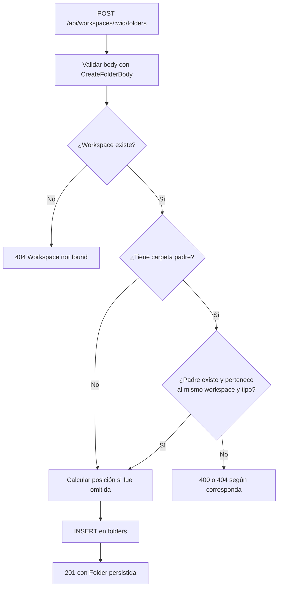
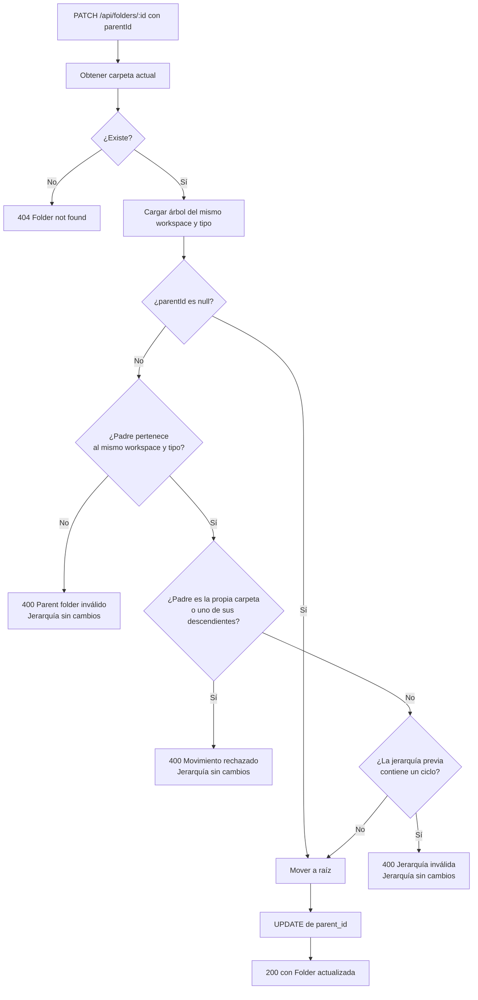
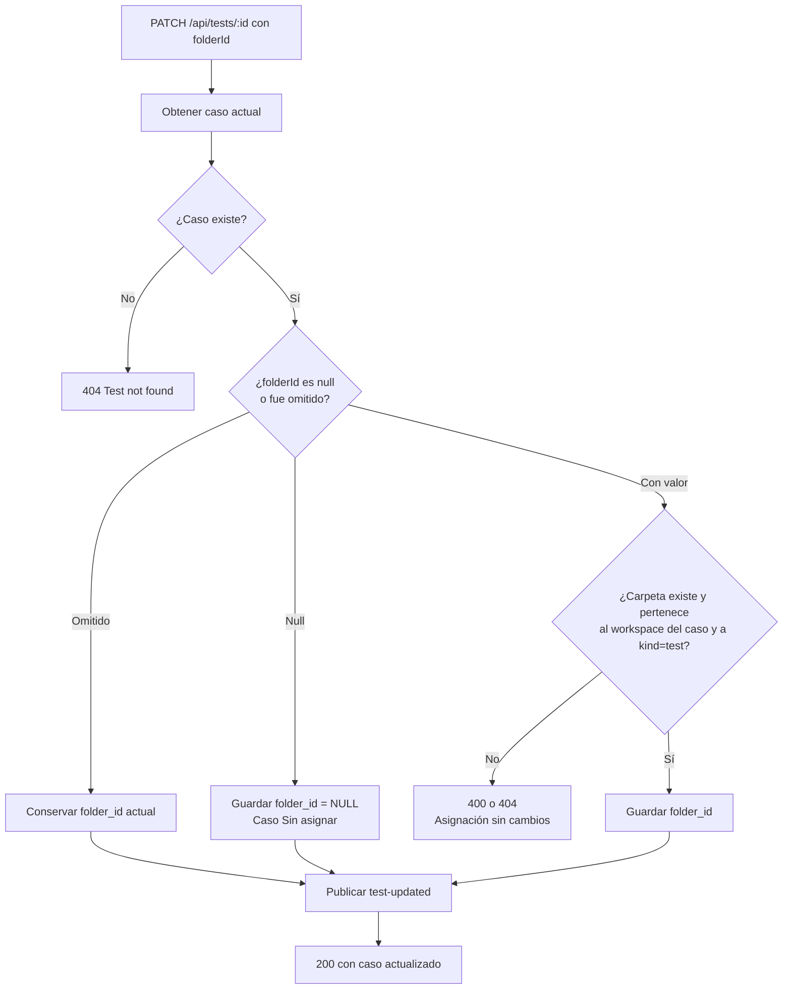
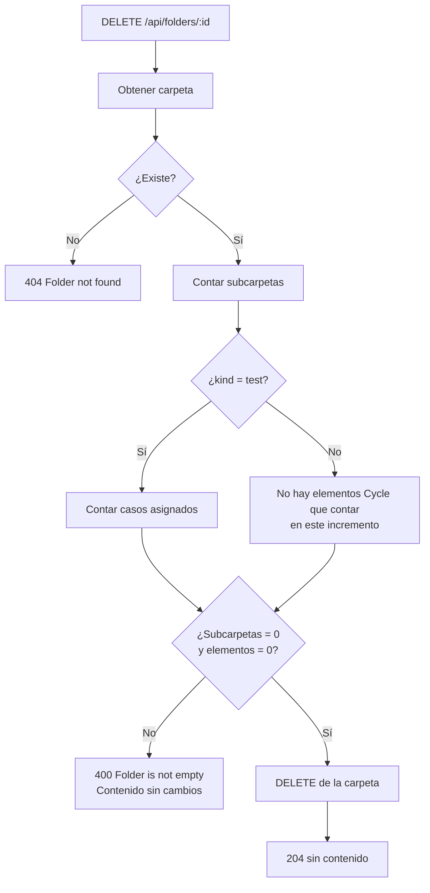
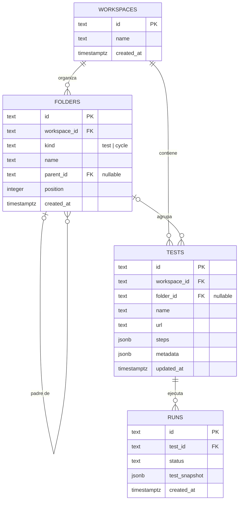
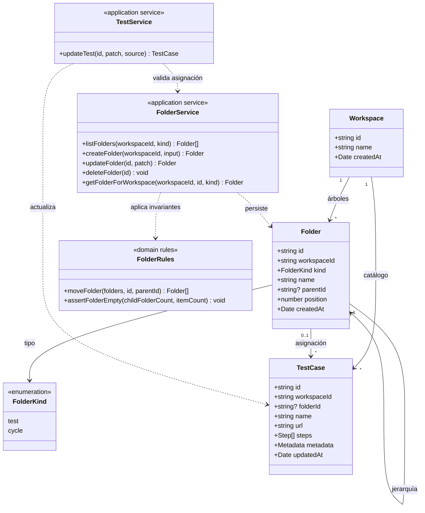

# 04 — Diagramas del slice de carpetas

Los diagramas describen únicamente la implementación backend realizada. La entidad Cycle todavía no existe; `FolderKind.cycle` solo reserva un árbol independiente para un incremento posterior.

## Flujo: crear una carpeta

## Flujo: mover una carpeta

## Flujo: asignar un caso a una carpeta

## Flujo: eliminar una carpeta

## Diagrama entidad-relación físico

Cardinalidades y reglas:

- Un caso pertenece a un workspace y puede tener cero o una carpeta.
- Una carpeta puede contener cero o varios casos y cero o varias subcarpetas.
- Una carpeta tiene como máximo un padre; `parent_id = NULL` representa la raíz.
- `tests.folder_id = NULL` representa **Sin asignar** y conserva los casos anteriores a la migración.
- `ON DELETE RESTRICT` impide borrar una carpeta con subcarpetas o casos; la aplicación valida antes para devolver un error comprensible.
- Runs conserva su snapshot y no cambia con la organización documental del caso.

## Diagrama de dominio

Invariantes de dominio implementadas:

1. Los árboles se aíslan por `workspaceId` y `FolderKind`.
2. La jerarquía es acíclica: una carpeta no puede ser padre de sí misma ni moverse bajo un descendiente.
3. Solo se elimina una carpeta vacía.
4. Un caso tiene una única ubicación opcional; no puede asignarse a una carpeta de otro workspace o al árbol `cycle`.
5. Cambiar la organización no altera pasos, metadatos ni snapshots de ejecución.
